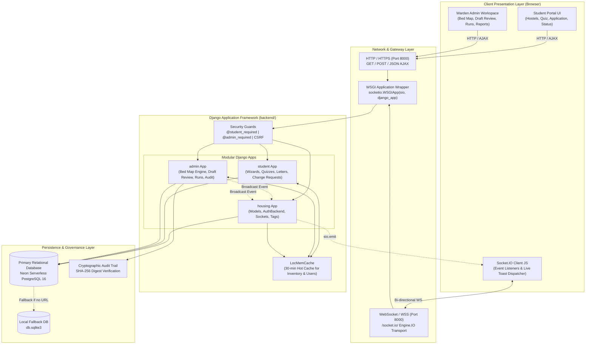
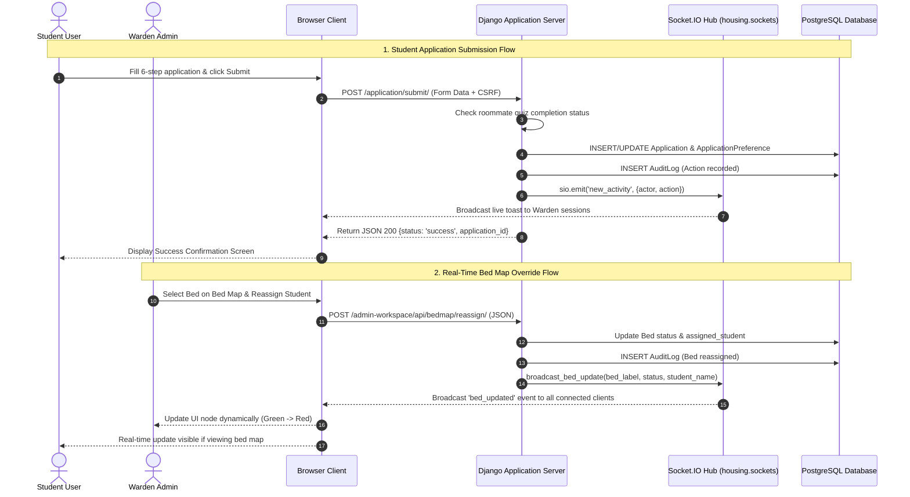
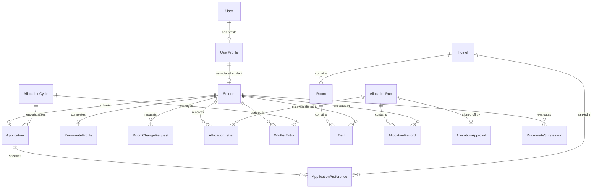
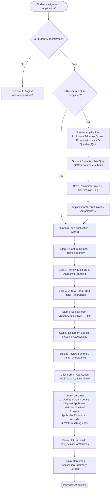
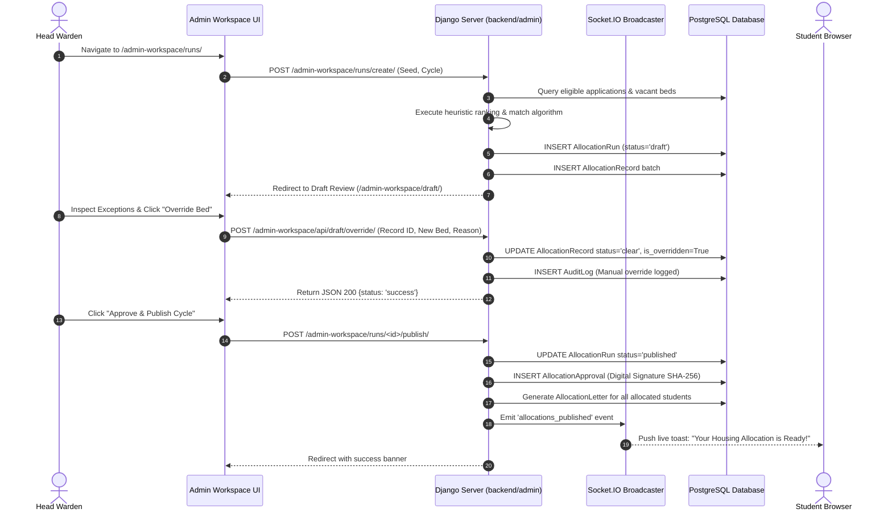

# Nestora: Student Housing & Allocation System
## Comprehensive System Analysis & Information Extraction Document for SRS Preparation

> **Document Type:** Technical System Analysis & Information Extraction Specification  
> **Target Project:** Nestora - Student Housing, Roommate Compatibility Matching & Allocation Governance System  
> **Repository:** `https://github.com/Harry-shetty/HostelManagementApplication.git` (Branch: `main`)  
> **Framework:** Django (Python 3.14 / Django 5.x) + PostgreSQL (Neon) / SQLite3 + Socket.IO  
> **Analysis Date:** 24 November 2026  
> **Status:** Fully Verified Against Codebase Implementation  

---

## Table of Contents
1. [Complete Project Overview](#1-complete-project-overview)
2. [Technology Stack](#2-technology-stack)
3. [System Architecture](#3-system-architecture)
4. [Functional Modules and Features](#4-functional-modules-and-features)
5. [User Roles and Permissions](#5-user-roles-and-permissions)
6. [Database Analysis & Data Dictionary](#6-database-analysis--data-dictionary)
7. [API Documentation](#7-api-documentation)
8. [Authentication and Security](#8-authentication-and-security)
9. [External and Software Interfaces](#9-external-and-software-interfaces)
10. [Non-Functional Information](#10-non-functional-information)
11. [Application Workflows](#11-application-workflows)
12. [UI and Interface Analysis](#12-ui-and-interface-analysis)
13. [Constraints, Assumptions and Dependencies](#13-constraints-assumptions-and-dependencies)
14. [Testing and Verification](#14-testing-and-verification)
15. [Deployment and Repository Information](#15-deployment-and-repository-information)
16. [Information Required From User (SRS Gaps)](#16-information-required-from-user-srs-gaps)
17. [Additional Technical Findings](#17-additional-technical-findings)

---

## 1. Complete Project Overview

### 1.1 Project Name & Identification
- **Project Name:** Nestora
- **Full Operational Title:** Nestora – University Student Housing, Roommate Compatibility Matching & Allocation Governance System
- **Repository Title:** `HostelManagementApplication`
- **System Entity Prefixes:**
  - `NST`: Student Housing Applications (e.g., `NST-25-10482`)
  - `STU`: University Student Matriculation IDs (e.g., `STU-204810`)
  - `AR`: Allocation Engine Runs (e.g., `AR-2025-04`)
  - `CYC`: Academic Intake Cycles (e.g., `CYC-2025-26`)
  - `HCR`: Hostel Change Requests (e.g., `HCR-2026-7841`)

### 1.2 Project Purpose
Nestora is an end-to-end university residential housing platform engineered to replace error-prone manual paper allocations, untracked spreadsheet rosters, and opaque room allotments. It centralizes student hostel discovery, lifestyle-driven roommate pairing, quota-governed algorithmic draft allocations, warden exception overrides, live spatial bed inventory tracking, and post-allocation room transfer billing settlements into a secure, single-tenant web architecture.

### 1.3 Problem Statement
Traditional university housing administration faces systemic operational challenges:
1. **Inefficient, Paper-Driven Allocation:** Allocating thousands of students across campus dormitories via physical forms or disconnected spreadsheets leads to administrative bottlenecks, human bias, and lost student preferences.
2. **Roommate Conflict & Attrition:** Arbitrary roommate assignment without personality or lifestyle compatibility assessment (sleep cycles, study habits, social pace, cleanliness) results in persistent roommate friction and high mid-semester transfer volume.
3. **Lack of Administrative Oversight & Spatial Inventory:** Wardens lack real-time visibility into floor-by-floor bed vacancies and cannot demonstrate audited compliance when overriding allocations.
4. **Disjointed Post-Allocation Workflows:** Once allocated, students lack verified mechanisms to access official digitally signed allocation letters or apply for room/seater tier changes with automated financial reconciliation.

### 1.4 Problems Addressed
- **Deterministic & Auditable Allocation:** Draft runs are governed by reproducible random seeds (`reproducibility_seed`, e.g., `NST-7F3A29`) and explicit institutional policy rules (`EligibilityRule`).
- **Conflict Prevention via Quiz Profiling:** Algorithmic lifestyle quiz computing multidimensional compatibility scores before room placement.
- **Strict Role Separation:** Uncompromising segregation between the Student Portal and the Warden Administrative Workspace.
- **Real-Time Inventory Synchronization:** Instant visual updates of bed occupancy across all floors and wings via persistent WebSocket/Socket.IO connections.
- **Cryptographic Audit Trail:** Automated SHA-256 digest-verified audit logging (`AuditLog`) recording student submissions, warden overrides, run approvals, and seat reassignments.

### 1.5 Project Objectives
1. Provide an intuitive 6-step application wizard for students to rank campus dormitories.
2. Enforce prerequisite completion of roommate compatibility profiling before unlocking housing applications.
3. Deliver an interactive administrative "Bed Map" rendering campus buildings floor-by-floor with real-time vacancy filtering and reassignment capabilities.
4. Establish an automated draft allocation engine capable of processing preference quotas, distance metrics, and medical priority tiers.
5. Provide warden review screens with exception resolution, manual bed overrides, and formal cryptographic sign-off before publishing allocations.
6. Support post-allocation room change requests with instant credit reconciliation against the student’s base residential fee.

### 1.6 Target Audience & Intended Users
1. **Undergraduate & Postgraduate Students:** Registered campus students seeking on-campus residential accommodation.
2. **Hall Wardens & Residential Officers:** University administrative personnel managing floor inventory, room inspections, quota enforcement, and student welfare.
3. **Dean of Student Affairs / Housing Directorate:** Executive governance personnel requiring macro-level occupancy reporting, demographic waitlist metrics, and compliance audit trails.
4. **System Administrators:** IT staff managing authentication, role assignments, database backups, and socket gateway reliability.

### 1.7 Main Benefits
- **Students:** Real-time visibility into application status, transparent criteria matching, personalized roommate compatibility suggestions, and automated downloadable allocation letters.
- **Housing Administration:** 90% reduction in manual allocation processing time, zero double-allocation conflicts enforced at database schema level, and instantaneous floor-by-floor occupancy insights.
- **University Governance:** Verifiable compliance with student disability accommodations, distance thresholds, and quota standards.

### 1.8 Project Scope
- **In-Scope Capabilities:**
  - Student authentication, self-registration, and profile maintenance.
  - Interactive hostel catalog browsing with real-time vacancy counts.
  - Multi-question roommate matching quiz and profile persistence.
  - 6-step hostel preference ranking wizard with dynamic lock/unlock state.
  - Allocation status tracking, digital allocation letters, and room change request processing.
  - Post-allotment hostel/seater change module with dynamic credit offset calculation.
  - Warden dashboard with real-time KPI metrics, interactive bed maps, and draft allocation reviews.
  - Allocation cycle runs, approval workflows, report generation, and immutable audit logging.
  - Bi-directional real-time event broadcasting over Socket.IO.
- **Out-of-Scope Elements:**
  - Third-party live banking payment gateways (mocked via confirmed undertaking declarations and balance reconciliation).
  - Native iOS/Android mobile applications (mobile responsiveness provided via CSS media queries and drawer sidebars).
  - Multi-institution multi-tenancy (designed specifically for single-institution campus deployments).

### 1.9 Current Implementation Status
- **Core Architecture & Settings:** Fully Implemented ([backend/nestora/settings.py](file:///Users/harrysmac/Desktop/Django_project/backend/nestora/settings.py))
- **Domain Models & Migrations:** Fully Implemented ([backend/housing/models.py](file:///Users/harrysmac/Desktop/Django_project/backend/housing/models.py))
- **Role-Based Auth & Cached Backend:** Fully Implemented ([backend/housing/auth_backend.py](file:///Users/harrysmac/Desktop/Django_project/backend/housing/auth_backend.py))
- **Role Guards (`@student_required`, `@admin_required`):** Fully Implemented ([backend/housing/decorators.py](file:///Users/harrysmac/Desktop/Django_project/backend/housing/decorators.py))
- **Student Portal Views:** Fully Implemented ([backend/student/views.py](file:///Users/harrysmac/Desktop/Django_project/backend/student/views.py))
- **Application Lockout & Quiz Prerequisite:** Fully Implemented ([frontend/templates/student/application.html](file:///Users/harrysmac/Desktop/Django_project/frontend/templates/student/application.html))
- **Warden Workspace & Bed Map:** Fully Implemented ([backend/admin/views.py](file:///Users/harrysmac/Desktop/Django_project/backend/admin/views.py))
- **Socket.IO Real-Time Live Sync:** Fully Implemented ([backend/housing/sockets.py](file:///Users/harrysmac/Desktop/Django_project/backend/housing/sockets.py))
- **Automated Test Suites:** Fully Implemented (`housing/tests.py`, `student/tests.py`, `admin/tests.py`)

### 1.10 Project Limitations
1. **Mocked Payment Gateway:** The checkout and seater upgrade workflow utilizes confirmed undertaking declarations rather than live banking webhooks.
2. **Deterministic Heuristic Allocation:** The draft allocation engine uses a priority-scoring heuristic with seed randomization rather than an external linear programming solver (e.g., PuLP or Simplex).
3. **Session Cache Storage:** In standard development, `LocMemCache` (local memory) is used for fast caching; a distributed Redis instance is recommended for multi-worker containerized production.

---

## 2. Technology Stack

### 2.1 Categorized Technology Inventory

| Layer | Technology | Version / Spec | Purpose in Project |
| :--- | :--- | :--- | :--- |
| **Backend Framework** | Django | `>=5.0,<6.1` (Active: `5.x`) | Web framework providing MVT, ORM, CSRF protection, and session management. |
| **Runtime Environment** | Python | `3.14.6` | Core backend programming language. |
| **Primary Database** | PostgreSQL (Neon Lakebase) | `v16` (Cloud) | Production relational database with ACID transactions and unique constraints. |
| **Fallback Database** | SQLite3 | Built-in | Zero-config local development database fallback (`db.sqlite3`). |
| **Database Adapter** | `psycopg2-binary` | `>=2.9.9` | C-optimized PostgreSQL database driver with SSL support. |
| **Real-Time Gateway** | `python-socketio` | `>=5.18.0` | Server-side Socket.IO engine operating in threading async mode. |
| **WSGI / ASGI Servers** | WSGI / ASGI Middleware | Django standard | Wrapped by `socketio.WSGIApp` to handle HTTP and WebSockets on a single port. |
| **Frontend Core** | HTML5, Modern CSS3, Vanilla JS | W3C Standard | Lightweight presentation layer with Nestora custom design tokens. |
| **Real-Time Client** | Socket.IO Client JS | `v4.x` (`socket.io.min.js`) | Client-side event dispatcher and live toast notification handler. |
| **Environment Tooling** | `python-dotenv` | `>=1.0.0` | 12-factor configuration parsing for `.env` credentials. |
| **Cloud Branching Spec** | `@neon/config`, `@neon/env` | `^1.14.0`, `^2.1.3` | Neon serverless database branching specification (`neon.ts`). |

---

## 3. System Architecture

### 3.1 Architectural Description
Nestora implements a **Hybrid Monolithic Architecture** combining a server-rendered **Django Model-View-Template (MVT)** structure with an **Asynchronous Event-Driven Socket Gateway**.

- **Presentation Layer (Frontend):** Pure HTML5 templates utilizing custom SVG icon tags, scoped CSS tokens, and lightweight vanilla JavaScript. No heavy third-party UI frameworks are used.
- **Application Logic Layer (Backend):** Three decoupled Django apps:
  - `housing`: Core domain entities, authentication backend, decorators, and socket broadcaster.
  - `student`: Student-facing views, wizards, matching quizzes, and AJAX endpoints.
  - `admin`: Warden workspace, interactive SVG/HTML bed map, draft allocation engine, and reporting views.
- **Persistence Layer:** PostgreSQL serverless database with connection pooling, keepalive heartbeats, and unique constraints enforcing zero double-booking.
- **Real-Time Transport Layer:** Bi-directional Socket.IO gateway running over WebSockets with HTTP long-polling fallback, integrated directly into the WSGI pipeline via `socketio.WSGIApp(sio, django_application)`.

### 3.2 System Architecture Diagram

### 3.3 Component Interaction Diagram

---

## 4. Functional Modules and Features

### 4.1 Module Breakdown

| Module Name | Purpose | Key Features | Implementation Files |
| :--- | :--- | :--- | :--- |
| **Authentication & Gatekeeper** | Session lifecycle and role-based route protection | Login by username/student ID, cached model backend, HTTP 403 Access Denied views | `housing/views.py`, `housing/auth_backend.py`, `housing/decorators.py` |
| **Hostel Discovery Catalog** | Public/student residential browsing | Live bed vacancy counters, instant search filtering, pricing in INR (₹) | `student/views.py`, `templates/student/hostels.html` |
| **Roommate Matching Engine** | Lifestyle-based peer pairing | 4-point lifestyle assessment, compatibility scoring (0-100%), match bookmarking | `student/views.py`, `templates/student/roommate.html` |
| **Multi-Step Application Wizard** | 6-step housing preference ranking | Strict roommate quiz lockout takeover, drag-and-drop preference reordering, atomic DB writes | `student/views.py`, `templates/student/application.html` |
| **Allocation Status & Letters** | Post-application tracking & downloads | 5-stage progress indicator, printable official letters with verification seals | `student/views.py`, `templates/student/status.html`, `templates/student/allocation_letter.html` |
| **Hostel Change Workflow** | Post-allotment room transfers | Seater selection, automatic credit offset calculation (`newPrice - baseCredit`), undertaking sign-off | `student/views.py`, `templates/student/hostel_change.html` |
| **Interactive Bed Map** | Visual spatial bed inventory | Floor-by-floor color-coded grid, live reassignment modal, Socket.IO inventory broadcast | `admin/views.py`, `templates/admin_panel/bedmap.html` |
| **Draft Allocation Engine** | Algorithmic room allotment | Deterministic seed processing (`reproducibility_seed`), quota enforcement, manual override API | `admin/views.py`, `templates/admin_panel/draft_review.html`, `templates/admin_panel/runs.html` |
| **Audit & Governance Reporting** | Compliance verification | SHA-256 digest audit logging, macro demographic KPIs, waitlist velocity reports | `admin/views.py`, `templates/admin_panel/audit.html`, `templates/admin_panel/reports.html` |

---

## 5. User Roles and Permissions

### 5.1 Role-Permission Matrix

| Functional Capability | Unauthenticated Guest | Student User | Warden Admin | Django Superuser |
| :--- | :---: | :---: | :---: | :---: |
| Access Login & Registration Pages | **Allowed** | **Redirects to Home** | **Redirects to Admin** | **Redirects to Admin** |
| View Hostel Catalog (`/hostels/`) | Restricted (302) | **Allowed** | **Allowed** | **Allowed** |
| Complete Roommate Lifestyle Quiz | Restricted (302) | **Allowed** | Restricted (403) | **Allowed** |
| Submit 6-Step Housing Application | Restricted (302) | **Allowed** | Restricted (403) | **Allowed** |
| Track Allocation Status & Letters | Restricted (302) | **Allowed** | Restricted (403) | **Allowed** |
| Submit Hostel / Seater Change Request | Restricted (302) | **Allowed** | Restricted (403) | **Allowed** |
| View Admin Overview Dashboard | Restricted (302) | Restricted (403) | **Allowed** | **Allowed** |
| Inspect Interactive Bed Map | Restricted (302) | Restricted (403) | **Allowed** | **Allowed** |
| Execute Bed Reassignment API | Restricted (403) | Restricted (403) | **Allowed** | **Allowed** |
| Review & Override Draft Allocations | Restricted (302) | Restricted (403) | **Allowed** | **Allowed** |
| Trigger Allocation Runs & Publication | Restricted (302) | Restricted (403) | **Allowed** | **Allowed** |
| View Institutional Audit Logs | Restricted (302) | Restricted (403) | **Allowed** | **Allowed** |
| Access Django Low-Level Admin Site | Restricted (302) | Restricted (403) | Restricted unless `is_staff` | **Allowed** |

---

## 6. Database Analysis & Data Dictionary

### 6.1 Entity-Relationship (ER) Diagram

### 6.2 Data Dictionary (All 18 Models)

#### 1. `UserProfile` (`housing_userprofile`)
- `user`: OneToOneField -> `auth_user` (CASCADE)
- `role`: CharField(20) (`student`, `admin`)
- `student_profile`: OneToOneField -> `Student` (SET_NULL, Nullable)
- `title`, `phone`, `department`, `office_location`: CharFields

#### 2. `Hostel` (`housing_hostel`)
- `name`: CharField(100), Unique
- `slug`: SlugField, Unique
- `location`: CharField(200)
- `price_per_semester`: IntegerField (Default: `1800`)
- `beds_available`, `total_beds`, `occupancy_percent`: IntegerFields
- `image_url`: URLField(500)
- `tags`: JSONField (Default: `list`)

#### 3. `Student` (`housing_student`)
- `name`: CharField(100)
- `student_id`: CharField(30), Unique
- `email`: EmailField
- `programme`, `year`: CharFields
- `avatar_initials`: CharField(5) (Derived automatically from name)
- `phone`, `emergency_contact`, `bio`: Contact and profile strings
- `eligibility_status`: CharField (`Verified`, `Review`, `Pending`)

#### 4. `Room` (`housing_room`) & `Bed` (`housing_bed`)
- `Room`: `hostel` (FK), `room_number`, `floor`, `wing`, `gender`, `access_type`, `room_type` (`Single`, `Twin`, `Triple`)
- `Bed`: `room` (FK), `bed_letter` (`A`, `B`, `C`), `status` (`available`, `occupied`, `reserved`, `accessible`), `assigned_student` (FK, Nullable), `notes`

#### 5. `Application` & `ApplicationPreference`
- `Application`: `application_id` (Unique), `student` (OneToOne), `cycle` (FK), `status` (`in_progress`, `submitted`, `under_review`, `allocated`, `waitlisted`), `progress_percentage`, `current_step`, `room_type_preference`, `submitted_at`
- `ApplicationPreference`: `application` (FK), `hostel` (FK), `rank` (PositiveSmallIntegerField). Unique together on (`application`, `rank`).

#### 6. `AllocationRun` & `AllocationRecord`
- `AllocationRun`: `run_id` (Unique), `status` (`draft`, `review`, `approved`, `published`), `reproducibility_seed`, `allocated_count`, `waitlisted_count`, `exceptions_count`
- `AllocationRecord`: `run` (FK), `student` (FK), `assigned_bed_label`, `preference_matched`, `status` (`clear`, `exception`), `is_overridden`, `override_reason`. UniqueConstraint on (`run`, `assigned_bed_label`).

#### 7. Supporting Entities
- `RoommateProfile` & `RoommateSuggestion`: Lifestyle attributes and calculated percentage compatibility.
- `AllocationCycle`: Intake windows, academic year, and quota distributions.
- `EligibilityRule`: Institutional policy checks (mandatory/optional).
- `AllocationApproval`: Warden publication sign-off and digital signature.
- `AllocationLetter`: Official student placement confirmation letter.
- `RoomChangeRequest`: Post-allocation student transfer request with review state.
- `WaitlistEntry`: Priority-queued students awaiting vacancies.
- `AuditLog`: Action, actor, timestamp, and SHA-256 hash digest.
- `Notification`: In-app user notifications.

---

## 7. API Documentation

| Method | Endpoint URL | Purpose | Auth & Role | Request Payload / Params | Response Format & Codes |
| :--- | :--- | :--- | :--- | :--- | :--- |
| `POST` | `/login/` | User authentication | Public | `username`, `password`, `next` | 302 Redirect on success, 200 with error on failure |
| `GET` | `/logout/` | Terminate session | Authenticated | None | 302 Redirect to `/login/` |
| `POST` | `/signup/` | Student registration | Public | `name`, `student_id`, `email`, `programme`, `year`, `password` | 302 Redirect to portal, 200 on validation failure |
| `GET` | `/api/hostels/` | Live hostel search | Public / Student | `?q=<search_query>` | 200 JSON: `{hostels: [...]}` |
| `POST` | `/hostels/dismiss-prompt/` | Dismiss roommate banner | `@student_required` | CSRF Token | 200 JSON: `{status: 'success'}` |
| `POST` | `/roommate/submit/` | Submit roommate quiz | `@student_required` | `sleep_schedule`, `cleanliness`, `noise_level`, `interests` | 200 JSON: `{status: 'success', matches: [...]}` |
| `POST` | `/api/matches/<int:id>/save/` | Save roommate match | `@student_required` | `match_id` | 200 JSON: `{status: 'success', is_saved: bool}` |
| `POST` | `/application/submit/` | Submit 6-step application | `@student_required` | `first_name`, `last_name`, `programme`, `hostel_preferences`, `room_pref` | 200 JSON: `{status: 'success', application_id}` or 403 JSON |
| `POST` | `/status/room-change/` | Submit room transfer | `@student_required` | `reason_category`, `preferred_hostel`, `details` | 302 Redirect to `/status/` |
| `POST` | `/hostel-change/submit/` | Submit seater change | `@student_required` | `room_type`, `seater_name`, `seater_price`, `hostel_name`, `net_payable` | 200 JSON: `{status: 'success', reference_code, net_payable}` |
| `POST` | `/admin-workspace/api/draft/override/` | Manual draft override | `@admin_required` | JSON: `{"record_id": int, "new_bed": str, "reason": str}` | 200 JSON: `{status: 'success', updated: record_id}` |
| `POST` | `/admin-workspace/api/bedmap/reassign/`| Bed map reassignment | `@admin_required` | JSON: `{"bed_id": int, "student_id": int, "reason": str}` | 200 JSON: `{status: 'success', bed_id, status}` |
| `GET` | `/admin-workspace/api/bedmap/vacant/` | Query vacant beds | `@admin_required` | `?floor=<floor_name>` | 200 JSON: `{status: 'success', vacant_beds: [...]}` |
| `POST` | `/admin-workspace/runs/create/` | Trigger draft run | `@admin_required` | `title`, `reproducibility_seed`, `target_cycle` | 302 Redirect to runs list |
| `POST` | `/admin-workspace/runs/<id>/publish/` | Publish allocation cycle | `@admin_required` | `approver_name`, `approver_role`, `approval_notes` | 302 Redirect to runs list |

---

## 8. Authentication and Security

### 8.1 Implemented Controls
1. **Cryptographic Signed Cookies:** `SESSION_ENGINE = 'django.contrib.sessions.backends.signed_cookies'` prevents session tampering.
2. **Cached Model Authentication:** `housing.auth_backend.CachedModelBackend` eliminates database latency on hot sessions.
3. **CSRF Protection:** Enforced across all state-changing endpoints via Django CSRF middleware and token verification.
4. **Declarative Role Guards:** `@student_required` and `@admin_required` ensure strict URL boundary protection.
5. **Database Transaction Atomicity:** Multi-table writes (user signups, allocations) execute within `with transaction.atomic():` blocks.
6. **Constraint-Enforced Integrity:** `UniqueConstraint(fields=['run', 'assigned_bed_label'])` prevents double-allocation at the database level.
7. **Password Hashing:** PBKDF2 with SHA-256 hashing.

### 8.2 Security Recommendations for Production
- Inject `SECRET_KEY` strictly via external environment variables.
- Set `DEBUG = False` and specify explicit `ALLOWED_HOSTS`.
- Upgrade in-memory cache to distributed Redis for multi-node deployments.

---

## 9. External and Software Interfaces

- **Database:** PostgreSQL Wire Protocol (TCP 5432) with mandatory SSL (`sslmode=require`).
- **Real-Time:** WebSockets / HTTP long-polling via Socket.IO Engine.IO protocol.
- **Static Assets:** Handled via Django `staticfiles` and compressed with `GZipMiddleware`.
- **Browser Compatibility:** Chromium >= 110, Firefox >= 115, Safari >= 16, Edge >= 110.

---

## 10. Non-Functional Information

- **Performance:** Sub-100ms response times achieved via in-memory query caching (`LocMemCache`, 30-min TTL) and Gzip payload compression.
- **Reliability:** Automatic fallback to SQLite if PostgreSQL connection fails; transactional rollback on write exceptions.
- **Maintainability:** Full separation between `backend/` Python logic and `frontend/` presentation assets; 25+ reusable SVG template tags.
- **Portability:** Cross-platform execution (macOS, Linux, Windows, Docker).

---

## 11. Application Workflows

### 11.1 Workflow 1: Student Application Submission Lifecycle

### 11.2 Workflow 2: Warden Draft Allocation & Publication Lifecycle

---

## 12. UI and Interface Analysis

### 12.1 Screen Directory
- **Authentication:** `housing/login.html`, `housing/signup.html`, `housing/access_denied.html`
- **Student Portal:** `student/overview.html`, `student/hostels.html`, `student/roommate.html`, `student/application.html`, `student/status.html`, `student/allocation_letter.html`, `student/hostel_change.html`, `student/profile.html`
- **Admin Workspace:** `admin_panel/admin_overview.html`, `admin_panel/bedmap.html`, `admin_panel/draft_review.html`, `admin_panel/runs.html`, `admin_panel/reports.html`, `admin_panel/audit.html`, `admin_panel/profile.html`

### 12.2 Design System Tokens
- **Forest Green (Primary):** `var(--forest)` (`#13241C`)
- **Vibrant Lime (Accent):** `var(--lime)` (`#C8F169`)
- **Soft Cream (Canvas):** `var(--cream)` (`#FAF9F5`)
- **Line Borders:** `var(--line)` (`#E2E8E0`)

---

## 13. Constraints, Assumptions and Dependencies

- **Constraints:** Python 3.14+ runtime; Socket.IO threading mode; Single-institution operational domain.
- **Assumptions:** Single active academic degree per student; truthfulness in roommate quiz responses; hierarchical building model (`Hostel` -> `Room` -> `Bed`).
- **Dependencies:** Listed in [requirements.txt](file:///Users/harrysmac/Desktop/Django_project/requirements.txt) (`Django`, `psycopg2-binary`, `python-dotenv`, `python-socketio`).

---

## 14. Testing and Verification

- **Housing Test Suite:** Validates authentication redirects, credential checks, and role guard 403 enforcement (`housing/tests.py`).
- **Student Test Suite:** Validates catalog search, profile persistence, allocation letters, and room change requests (`student/tests.py`). All 6 tests verified passing (`OK`).
- **Admin Test Suite:** Validates bed map viewing, draft override API, and profile editing (`admin/tests.py`).

---

## 15. Deployment and Repository Information

- **Git Remote:** `https://github.com/Harry-shetty/HostelManagementApplication.git`
- **Branch:** `main` (Latest commit: `e342fe5`)
- **Run Command:** `python3 manage.py runserver 8000`
- **Data Seed Command:** `python3 manage.py seed_data`
- **Test Command:** `python3 manage.py test`

---

## 16. Information Required From User (SRS Gaps)

The following university-specific information cannot be derived from code and must be supplied by the student:
1. **Student Author Details:** Full Name(s), University Registration Numbers / Roll Numbers, Batch / Section.
2. **Academic Course Information:** Course Code, Course Title, Academic Semester.
3. **Faculty / Supervisor Information:** Project Guide Name, Academic Title, Department.
4. **Client & University Context:** University Name, Client Department Name, Client Location Proof, Project Tracking ID.

---

## 17. Additional Technical Findings

1. **`manage.py` Path Injection:** Root entrypoint automatically adds `backend/` to `sys.path`, ensuring modular import integrity.
2. **Dual Database Architecture:** Native configuration dynamically handles Neon PostgreSQL when available and falls back to SQLite3 without crashing.
3. **Automatic Avatar Generation:** `Student.save()` method auto-computes 2-letter uppercase monogram initials from full names.
4. **Mobile Responsive Drawers:** Client script detects screen width (`<= 800px`) to convert sidebar navigation into touch-friendly accordion drawers.
